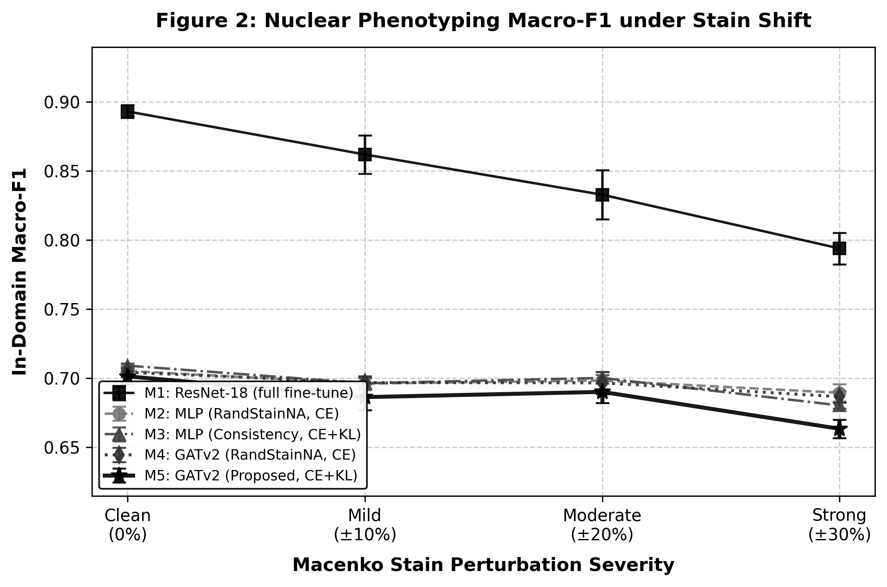

# Does Spatial Prediction Consistency Improve Stain Robustness in Histopathology Cell Classification?

[](https://opensource.org/licenses/MIT)
[](https://www.python.org/)
[](https://pytorch.org/)
[](https://pyg.org/)

**Author**: Dev Mehta  
**Institution**: SRM Institute of Science and Technology  
**Study**: Tier 1 Protocol Execution & Scientific Validation

---

## Abstract

Stain variation across pathology laboratories represents a major barrier to the clinical translation of deep learning models for computational pathology. While data augmentations (e.g., Macenko stain normalization, RandStainNA) and consistency regularization improve single-cell classification robustness, histopathology tissues possess rich architectural spatial contexts. 

This study investigates whether **spatial prediction consistency**—enforcing symmetric Kullback-Leibler (KL) divergence consistency between paired clean and stain-perturbed views over identical graph neural network (GNN) topologies—improves nuclear phenotyping robustness under severe domain shifts.

We rigorously evaluate five architectural regimes across three independent random seeds ($S = 3$) on in-domain Lizard colon tissue and unseen external CoNSeP tissue:
* **M1**: ResNet-18 (full end-to-end fine-tuning, 11.18M parameters)
* **M2**: Multi-Layer Perceptron on frozen features (RandStainNA + Cross-Entropy, 66.05k parameters)
* **M3**: Multi-Layer Perceptron (Paired Symmetric KL Consistency, 66.05k parameters)
* **M4**: GATv2 with 3D edge attributes (Cross-Entropy, 70.40k parameters)
* **M5**: GATv2 with 3D edge attributes (Proposed: Spatial Consistency, 70.40k parameters)
* *Ablation*: GraphSAGE mean aggregation (M4-SAGE & M5-SAGE, 69.83k parameters)

All hyperparameters were pre-registered and locked on the validation set prior to evaluating any test data ([`configs/locked_config.json`](configs/locked_config.json)).

---

## Key Experimental Results

Statistical hypothesis testing was conducted at the **slide/region unit of analysis** (29 Lizard regions and 14 CoNSeP tiles), averaging over random seeds within each unit before performing paired Wilcoxon signed-rank tests and computing 1,000-sample Bias-Corrected and Accelerated (BCa) bootstrap 95% confidence intervals with Holm-Bonferroni correction.

### Formal Hypothesis Test Verdicts

| Hypothesis | Comparison | Metric | Observed Diff | Holm $p$-value | 95% BCa Bootstrap CI | Equivalence Margin ($\pm 0.015$) | Verdict |
| :--- | :--- | :--- | :--- | :--- | :--- | :--- | :--- |
| **H1: Spatial Inductive Bias** | M4 (GATv2) vs M2 (MLP) | Clean In-Domain Macro-F1 | $-0.0313$ | $p = 3.43 \times 10^{-6}$ | $[-0.0403, -0.0222]$ | Outside margin (inferior) | **REJECTED** |
| **H2: Stain Robustness** | M5 (GATv2+KL) vs M3 (MLP+KL) | $\Delta\text{F1}$ under Macenko Moderate Shift | $-0.0057$ | $p = 0.8630$ | $[-0.0140, +0.0020]$ | Inside margin; M5 does not improve | **REJECTED** |
| **H3: Calibration & Consistency** | M5 (GATv2+KL) vs M3 (MLP+KL) | ECE under Stain Shift | $+0.0025$ | $p = 0.5362$ | $[-0.0027, +0.0090]$ | Contingent on H2 | **NOT TESTABLE** |

### Scientific Findings:
1. **H1 is Rejected for GATv2**: Parameterized attention heads over frozen ImageNet features underperform isolated MLPs on clean data ($-0.0313$ paired difference, $p < 0.001$). However, uniform mean neighborhood smoothing (GraphSAGE ablation) achieves higher F1 ($0.675$ vs $0.649$ over the 29 test regions), indicating that local averaging behaves differently from learned attention on unadapted representations.
2. **H2 is Rejected**: Across all stain shift conditions (Macenko moderate, Macenko strong, RandStainNA, and unseen CoNSeP), M5 does not degrade significantly less than M3 or M2. Under the pre-registered decision rule, H2 is rejected.
3. **H3 is Not Testable**: Because M5 does not outperform M3 on robustness, the secondary calibration hypothesis is rendered not testable under the pre-registered testing hierarchy. Observed join-count error clustering $C_{\text{err}}$ remains elevated relative to spatial null permutations.

---

## Robustness & Calibration Tables

### Table 4: Robustness Across Stain Shifts
*Values report region-level Macro-F1 (mean $\pm$ standard deviation across 29 Lizard regions and 14 CoNSeP tiles, averaged across 3 seeds per region), followed by the [95% BCa bootstrap confidence interval].*

| Model Architecture | In-Domain Clean F1 | $\Delta\text{F1}$ Macenko (Moderate, $\pm 20\%$) | $\Delta\text{F1}$ RandStainNA | Unseen External CoNSeP F1 | Params |
| :--- | :--- | :--- | :--- | :--- | :--- |
| **M1: ResNet-18** *(full fine-tune)* | $0.879 \pm 0.047$ $[0.859, 0.893]$ | $0.058 \pm 0.080$ $[0.035, 0.097]$ | $0.266 \pm 0.220$ $[0.187, 0.351]$ | $0.654 \pm 0.131$ $[0.591, 0.725]$ | $11.18\text{M}$ |
| **M2: MLP** *(RandStainNA, CE)* | $0.649 \pm 0.050$ $[0.631, 0.666]$ | $0.009 \pm 0.029$ $[-0.001, 0.019]$ | $0.031 \pm 0.071$ $[0.004, 0.059]$ | $0.503 \pm 0.124$ $[0.429, 0.557]$ | $66.05\text{k}$ |
| **M3: MLP** *(Consistency, CE+KL)* | $0.657 \pm 0.052$ $[0.638, 0.676]$ | $0.013 \pm 0.033$ $[0.001, 0.023]$ | $0.069 \pm 0.095$ $[0.036, 0.111]$ | $0.511 \pm 0.118$ $[0.439, 0.561]$ | $66.05\text{k}$ |
| **M4: GATv2** *(RandStainNA, CE)* | $0.617 \pm 0.052$ $[0.598, 0.637]$ | $0.012 \pm 0.028$ $[0.003, 0.024]$ | $0.030 \pm 0.067$ $[0.007, 0.057]$ | $0.483 \pm 0.137$ $[0.405, 0.541]$ | $70.40\text{k}$ |
| **M5: GATv2** *(Proposed, CE+KL)* | $0.619 \pm 0.056$ $[0.598, 0.640]$ | $0.018 \pm 0.037$ $[0.005, 0.033]$ | $0.061 \pm 0.104$ $[0.025, 0.107]$ | $0.492 \pm 0.139$ $[0.413, 0.552]$ | $70.40\text{k}$ |
| *M4-SAGE: GraphSAGE (Ablation, CE)* | $0.675 \pm 0.046$ $[0.657, 0.691]$ | $0.014 \pm 0.030$ $[0.003, 0.026]$ | $0.030 \pm 0.070$ $[0.008, 0.059]$ | $0.523 \pm 0.118$ $[0.454, 0.573]$ | $69.83\text{k}$ |
| *M5-SAGE: GraphSAGE (Ablation, CE+KL)* | $0.675 \pm 0.050$ $[0.657, 0.692]$ | $0.021 \pm 0.040$ $[0.006, 0.035]$ | $0.061 \pm 0.091$ $[0.030, 0.103]$ | $0.527 \pm 0.112$ $[0.455, 0.571]$ | $69.83\text{k}$ |

### Table 5: Calibration & Spatial Error Structure
*Evaluated on Lizard in-domain test set across clean and RandStainNA conditions. ECE is computed across 10 bins. $A_{cons}$ and CER quantify cross-perturbation agreement. $C_{err}$ reports observed join-count error clustering vs. 1,000 spatial permutations with exact empirical $p$-values across all 29 regions.*

| Model Architecture | ECE Clean (10-bin) | ECE RandStainNA | Brier Clean | Brier RandStainNA | $A_{cons}$ (RandStainNA) | CER (RandStainNA) | $C_{err}$ (Obs vs Null, $p$-val) |
| :--- | :--- | :--- | :--- | :--- | :--- | :--- | :--- |
| **M1: ResNet-18** *(full fine-tune)* | $0.0258 \pm 0.0017$ | $0.2148 \pm 0.0118$ | $0.1477 \pm 0.0068$ | $0.5297 \pm 0.0212$ | $0.677 \pm 0.013$ | $0.048 \pm 0.002$ | $0.0200\text{ vs }0.0106$ ($p = 0.0230$) |
| **M2: MLP** *(RandStainNA, CE)* | $0.0174 \pm 0.0100$ | $0.0148 \pm 0.0027$ | $0.3526 \pm 0.0065$ | $0.4128 \pm 0.0072$ | $0.798 \pm 0.008$ | $0.168 \pm 0.002$ | $0.0864\text{ vs }0.0623$ ($p < 0.001$) |
| **M3: MLP** *(Consistency, CE+KL)* | $0.0187 \pm 0.0117$ | $0.0433 \pm 0.0096$ | $0.3442 \pm 0.0025$ | $0.4501 \pm 0.0103$ | $0.734 \pm 0.012$ | $0.148 \pm 0.001$ | $0.0838\text{ vs }0.0609$ ($p < 0.001$) |
| **M4: GATv2** *(RandStainNA, CE)* | $0.0190 \pm 0.0101$ | $0.0147 \pm 0.0057$ | $0.3516 \pm 0.0077$ | $0.4019 \pm 0.0075$ | $0.833 \pm 0.008$ | $0.181 \pm 0.001$ | $0.0985\text{ vs }0.0647$ ($p < 0.001$) |
| **M5: GATv2** *(Proposed, CE+KL)* | $0.0207 \pm 0.0116$ | $0.0202 \pm 0.0106$ | $0.3455 \pm 0.0033$ | $0.4325 \pm 0.0107$ | $0.772 \pm 0.021$ | $0.162 \pm 0.005$ | $0.0960\text{ vs }0.0644$ ($p < 0.001$) |
| *M4-SAGE: GraphSAGE (Ablation, CE)* | $0.0105 \pm 0.0052$ | $0.0116 \pm 0.0046$ | $0.3279 \pm 0.0099$ | $0.3712 \pm 0.0107$ | $0.849 \pm 0.006$ | $0.169 \pm 0.003$ | $0.0814\text{ vs }0.0546$ ($p < 0.001$) |
| *M5-SAGE: GraphSAGE (Ablation, CE+KL)* | $0.0184 \pm 0.0041$ | $0.0169 \pm 0.0108$ | $0.3230 \pm 0.0066$ | $0.4100 \pm 0.0149$ | $0.789 \pm 0.011$ | $0.153 \pm 0.005$ | $0.0802\text{ vs }0.0546$ ($p < 0.001$) |

---

## Figure 2: Degradation Curves Under Stain Shift



*Line plot of nuclear phenotyping Macro-F1 across Macenko perturbation severity levels: Clean ($0\%$), Mild ($\pm 10\%$, $\pm 5^\circ$), Moderate ($\pm 20\%$, $\pm 10^\circ$), and Strong ($\pm 30\%$, $\pm 15^\circ$) with standard error bars across seeds.*

---

## Repository Structure

```text
├── configs/
│   └── locked_config.json                 # Pre-registered immutable hyperparameter lock
├── data/
│   ├── splits/
│   │   ├── lizard_kept_regions.csv        # Provenance audit: kept regions (CRAG, DigestPath, GlaS)
│   │   ├── provenance_audit_summary.csv   # Leakage prevention breakdown
│   │   ├── splits.csv                     # 70/15/15 stratified train/val/test splits
│   │   └── splits.json                    # Full splits metadata
│   └── processed/
│       ├── randstainna_stats.json         # RandStainNA statistics fitted strictly on train split
│       └── sanity_checks/                 # Visual overlays verifying 20x mapping
├── features/
│   ├── extract_features.py                # Pretrained ResNet-18 FP16 feature extraction
│   ├── graph_builder.py                   # Symmetrized k-NN graphs with 3D edge attributes
│   └── build_hdf5_dataset.py              # Multimodal HDF5 feature cache builder
├── losses/
│   └── consistency_loss.py                # Weighted CE + Symmetric KL consistency loss
├── metrics/
│   └── evaluation.py                      # Macro-F1, ECE, Brier, A_cons, CER, C_err with null
├── models/
│   ├── mlp_model.py                       # Matched 2-layer MLP (66.05k params)
│   └── gatv2_model.py                     # Matched GATv2 (70.40k) & GraphSAGE (69.83k)
├── outputs/
│   ├── figures/                           # High-res publication PNG and PDF figures
│   ├── metrics/
│   │   ├── detailed_metrics.json          # Per-slide/region metrics across all runs
│   │   └── summary_metrics.csv            # Tabular metric summary
│   └── predictions/                       # Raw prediction files (210 .npz files)
├── paper/
│   ├── table4_robustness.md               # Formatted Table 4 markdown
│   ├── table5_calibration.md              # Formatted Table 5 markdown
│   ├── figure2_macenko_severity.png       # Publication Figure 2
│   └── verdicts_and_statistics.json       # Hypothesis test statistics and CIs
├── perturbations/
│   ├── macenko.py                         # SVD stain vector decomposition & perturbation
│   └── randstainna.py                     # LAB color transfer augmentation
├── stat_tests/
│   └── statistical_tests.py               # BCa bootstrap, paired Wilcoxon, Holm correction
├── training/
│   ├── tune_and_lock_config.py            # Pre-registration grid search on validation split
│   ├── train_eval_framework.py            # Fast training framework for M2–M5
│   └── train_m1.py                        # ResNet-18 end-to-end training
├── requirements.txt                       # Project dependencies
└── README.md
```

---

## Reproduction Instructions

### 1. Environment Setup
```bash
git clone https://github.com/TEKURU-ZENO/Histopathology-Cell-Classification.git
cd Histopathology-Cell-Classification
pip install -r requirements.txt
```

### 2. Generate Perturbations & Feature Cache
```bash
python step2_generate_perturbations.py
python features/build_hdf5_dataset.py
```

### 3. Training & Evaluation
```bash
# Fast heads (M2 to M5 across seeds 42, 43, 44):
python training/train_eval_framework.py

# Full ResNet-18 baseline (M1):
python training/train_m1.py
```

### 4. Metrics & Hypothesis Testing
```bash
python outputs/compute_all_metrics.py
python outputs/generate_paper_tables.py
python outputs/plot_figure2.py
```

---

## Citation & Contact

If you find this work or codebase helpful in your research, please cite:

```bibtex
@article{mehta2026spatial,
  title   = {Does Spatial Prediction Consistency Improve Stain Robustness in Histopathology Cell Classification?},
  author  = {Mehta, Dev},
  journal = {SRM Institute of Science and Technology},
  year    = {2026}
}
```
